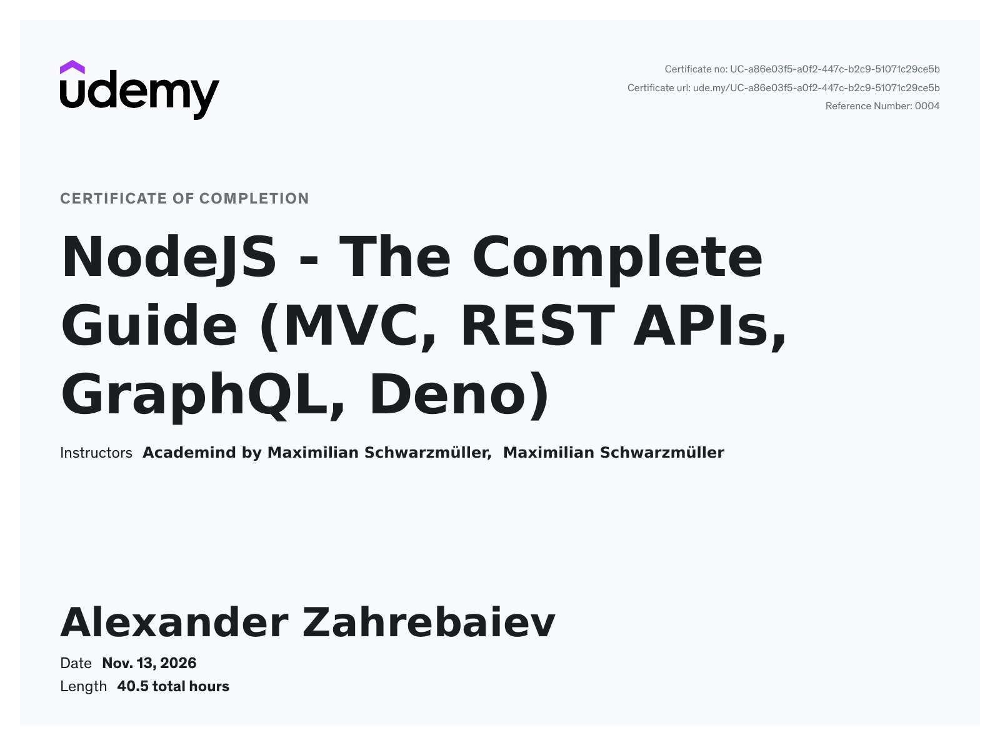
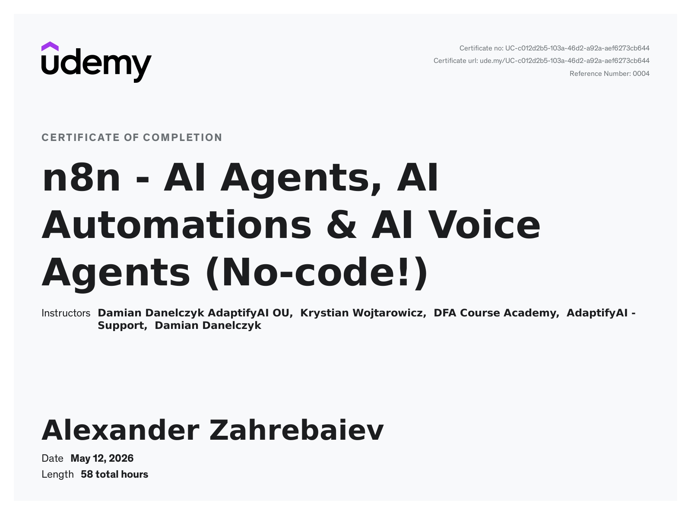

# Hi, I'm Alexander 👋

## About Me

I'm a full-stack web developer with 15+ years of experience building scalable PHP, Laravel, and WordPress applications.

Over the years, I’ve evolved from traditional backend development into **automation, integrations, and AI-driven systems** — building workflows that connect APIs, services, and modern AI agents using tools like Node.js, n8n, and MCP (Model Context Protocol).

I enjoy turning complex business logic into clean, maintainable, and automated systems.

Outside of development, I'm an amateur radio operator (HAM) with the callsign **UW5EMC**, passionate about radio communications and global connectivity experiments.

---

## Current Focus

- 🤖 AI agent integrations using MCP (Model Context Protocol)
- ⚡ Workflow automation with n8n and Node.js
- 🔌 API integrations and system orchestration
- 🧠 Connecting LLMs (Claude, ChatGPT, etc.) to real-world systems
- 🌐 Laravel / WordPress development and modernization

---

## Tech Stack

### Backend
- PHP
- Laravel
- Node.js

### Frontend
- JavaScript (Vanilla / jQuery)
- HTML5
- CSS3

### CMS / E-commerce
- WordPress
- WooCommerce

### Legacy & Maintenance Work
- Legacy PHP applications (custom frameworks)
- Refactoring and modernization of old PHP/MySQL systems
- API wrappers for legacy integrations
- Migration of old systems to Laravel / modern architecture

### Automation & AI
- n8n
- MCP (Model Context Protocol)
- Zoho Deluge
- REST APIs
- Webhooks
- AI integrations (Claude, ChatGPT, etc.)

### Databases
- MySQL

### Tools
- Git
- GitHub
- Serverless functions

---

## Experience

### CRMOZ
**Developer**  
Aug 2025 – Present  
Building CRM integrations, workflow automation systems, and AI-driven business solutions.

---

### DianSoftware (Part-time)
**Web Developer**  
Oct 2021 – Jun 2025  
Custom WordPress development, Laravel applications, API integrations, and client solutions.

---

### DevTech (Self-employed)
**Web Developer**  
Mar 2015 – 2021  
Full-stack web development for business clients in Ukraine and remote projects.

---

### PrComm
**Back-End Web Developer**  
Sep 2007 – Feb 2015  
Backend systems, PHP development, and long-term enterprise web projects.

---

## Projects

- 🔧 **[HF Toolkit](https://github.com/I3rixon/hf-toolkit)**  
  Browser-based toolkit for amateur HF radio operations

- 🤖 **Profile README**  
  This GitHub profile

> More automation, Laravel, and AI-related projects coming soon.

---

## Certifications

- 🎓 **[NodeJS - The Complete Guide (MVC, REST APIs, GraphQL, Deno)](https://ude.my/UC-a86e03f5-a0f2-447c-b2c9-51071c29ce5b)**  
  Udemy · Nov 2026 · 40.5 hours  
  Instructors: Academind by Maximilian Schwarzmüller, Maximilian Schwarzmüller

  

- 🎓 **[n8n - AI Agents, AI Automations & AI Voice Agents (No-code!)](https://ude.my/UC-c012d2b5-103a-46d2-a92a-aef6273cb644)**  
  Udemy · May 2026 · 58 hours  
  Instructors: Damian Danelczyk, Krystian Wojtarowicz, DFA Course Academy (AdaptifyAI OU)

  

---

## GitHub Stats

---

## Skills Summary

**Backend:** PHP, Laravel, Node.js  
**Frontend:** JavaScript, HTML, CSS  
**CMS:** WordPress, WooCommerce  
**Automation:** n8n, MCP, Deluge, APIs, Webhooks  
**Database:** MySQL  
**Tools:** Git, GitHub, Serverless

---

## Contact

- 📧 Email: [lulzsecer@gmail.com](mailto:lulzsecer@gmail.com)
- 💼 LinkedIn: [Profile](https://www.linkedin.com/in/devtechdpua/)

---

## Amateur Radio

Licensed HAM operator: **UW5EMC** 🇺🇦  
Interested in HF communication, digital modes, and radio experimentation.

---

Thank you for visiting my profile 🚀
